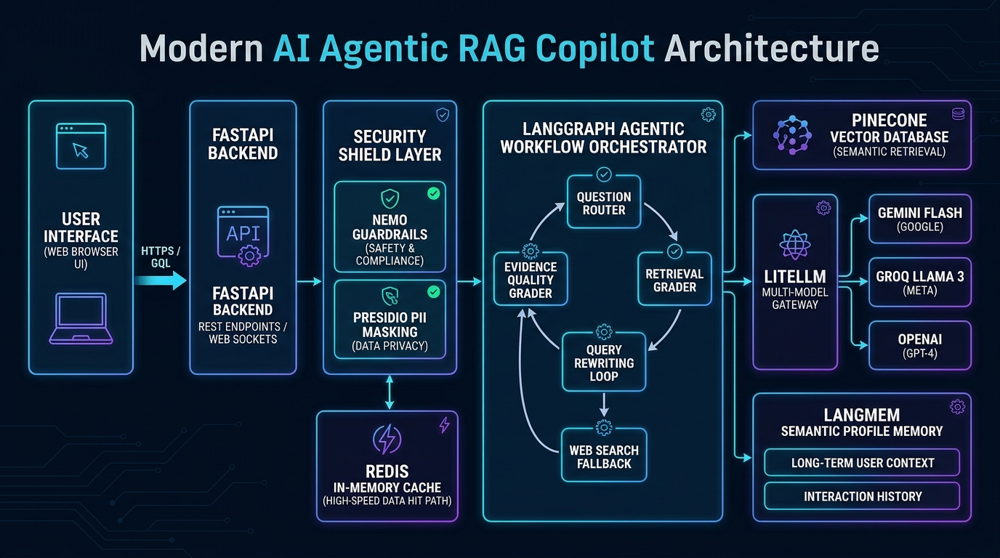

# 🏢 Enterprise HR Policy & Employee Support Agentic RAG Copilot

[](https://www.python.org/)
[](https://fastapi.tiangolo.com/)
[](https://langchain-ai.github.io/langgraph/)
[-green.svg)](Dockerfile)
[](k8s/)
[](terraform/)
[](tests/)

An enterprise-ready, production-grade **Agentic RAG HR Copilot** designed for modern organizations. Built with **LangGraph, FastAPI, Pinecone Vector DB, Redis Caching, NeMo Guardrails, Presidio PII Masking, LiteLLM Gateway, Keycloak RBAC, Terraform, and AWS EKS**.

---

## 🏛️ Development & Agentic Workflow Architecture



<details>
<summary><b>Click to expand ASCII Workflow Diagram</b></summary>

                                  👨‍💼 Employee / HR Admin
                                             │
                                             ▼
                               ┌───────────────────────────┐
                               │  HTML5/CSS3/JS Web App    │
                               │  Feedback + Trace UI      │
                               └─────────────┬─────────────┘
                                             │ POST /api/chat
                                             ▼
                               ┌───────────────────────────┐
                               │     AWS ALB / Ingress     │
                               └─────────────┬─────────────┘
                                             │
                                             ▼
                               ┌───────────────────────────┐
                               │    FastAPI Application    │
                               │   (Non-Root Pods in EKS)  │
                               └─────────────┬─────────────┘
                                             │
            ┌────────────────────────────────┼────────────────────────────────┐
            │                                │                                │
            ▼                                ▼                                ▼
┌───────────────────────┐        ┌───────────────────────┐        ┌───────────────────────┐
│ 🛡️ NeMo Guardrails   │        │ 🔐 Presidio PII Engine│        │ 🔑 Keycloak IAM / RBAC│
│ Colang Injection Block│        │ Anonymize SSN/Phones  │        │ JWT RS256 Validation  │
└───────────────────────┘        └───────────────────────┘        └───────────────────────┘
            │                                │                                │
            └────────────────────────────────┼────────────────────────────────┘
                                             │
                                             ▼
                               ┌───────────────────────────┐
                               │  ⚡ Redis Fast-Path Cache  │ ──<5ms Hit──→ [Direct Response]
                               │  Rate Limit (30 req/min)  │
                               └─────────────┬─────────────┘
                                             │ (Cache Miss)
                                             ▼
                               ┌───────────────────────────┐
                               │  LangGraph State Machine  │
                               │  Router → Grader → Retry  │
                               └─────────────┬─────────────┘
                                             │
                      ┌──────────────────────┴──────────────────────┐
                      ▼                                             ▼
          ┌───────────────────────┐                     ┌───────────────────────┐
          │ 🌲 Pinecone Vector DB │                     │ 🌐 Tavily Search API  │
          │ Company HR Handbook   │                     │ (External Fallback)   │
          └───────────┬───────────┘                     └───────────┬───────────┘
                      │                                             │
                      └──────────────────────┬──────────────────────┘
                                             │
                                             ▼
                               ┌───────────────────────────┐
                               │ 🤖 LiteLLM Model Gateway  │
                               │ Gemini 3.8 / Groq 120B /  │
                               │ OpenAI 4o-mini Fallbacks  │
                               └─────────────┬─────────────┘
                                             │
                                             ▼
                               ┌───────────────────────────┐
                               │ 🧠 LangMem Memory Store   │
                               │ Semantic Employee Profile │
                               └───────────────────────────┘
```
</details>

---


## 🌟 Key Enterprise Pillars

### 1. 🤖 Agentic RAG Workflow (LangGraph)
- **Private Knowledge First**: Queries private Pinecone vector database before ever touching public networks.
- **Evidence Grader**: Evaluates retrieved chunks; if confidence is low, it invokes **Tavily Web Search** as a fallback.
- **Self-Correction Loops**: Automatically rewrites ambiguous questions and retries before safely reporting insufficient evidence.

### 2. 🛡️ AI Guardrails & PII Data Protection
- **NVIDIA NeMo Guardrails**: Enforces Colang rails to block prompt injections, jailbreaks, system-prompt leakage, and off-topic requests.
- **Microsoft Presidio PII Masking**: Automatically detects and anonymizes Sensitive Personal Identifiable Information (SSN, credit card numbers, phone numbers, email addresses) before sending queries to external LLMs.

### 3. 🌐 Model Gateway & Cost Control (LiteLLM)
- Multi-model intelligent routing:
  - **Primary Tier**: Google Gemini Flash (`gemini/gemini-2.5-flash` / `gemini/gemini-3.8-flash`) for low-cost, ultra-fast responses.
  - **Secondary Tier**: Groq (`groq/llama-3.3-70b-versatile` / `groq/gpt-oss-120b`) for deep open-weight reasoning.
  - **Fallback Tier**: OpenAI (`gpt-4o-mini`).
- Automated fallback upon provider outage (429 or 500 status codes).
- Real-time token usage and cost calculation ($ cents) logged on every request.

### 4. 🔑 Enterprise Identity & Access Control (Keycloak)
- Secure **JWT Bearer Token (RS256)** validation.
- Role-Based Access Control (**RBAC**):
  - `employee`: Standard chat access, personal memory retention.
  - `hr_admin`: Document ingestion (`/api/ingest`), knowledge management, and audit log inspection (`/api/audit`).

### 5. ⚡ Redis Caching & Sliding-Window Rate Limiting
- **Sub-5ms Query Cache**: Frequently asked questions are returned instantaneously without invoking LLM pipelines.
- **Auto-Invalidation**: Whenever an HR admin uploads a new policy document, related cache keys are purged automatically.
- **Anti-Abuse Rate Limiter**: 30 requests/minute per client using a Redis sliding-window algorithm.

### 6. 🧠 Long-Term Semantic Profile Memory (LangMem)
- Extracts and remembers user context (e.g. employee department, office location, employment tier).
- Recalls past profile facts in subsequent conversation sessions without requiring repeated input.

### 7. 🐳 Hardened Docker Container Security
- **Multi-stage build**: Builder environment is completely discarded in the final image.
- **Non-Root Execution**: Runs under least-privilege user `appuser:appgroup` (**UID 1001:1001**).
- Zero secrets, logs, or cache files baked into container layers.

### 8. ☁️ Cloud Infrastructure as Code (Terraform & AWS EKS)
- Fully automated Terraform modules in [terraform/](terraform/):
  - **Multi-AZ VPC** with dedicated Public Subnets (ALB) and Private Subnets (Worker Nodes).
  - **AWS EKS Control Plane v1.30** with CloudWatch audit logging.
  - **EKS Managed Node Groups** with autoscaling (2 to 6 nodes).
  - **OIDC & IRSA** for AWS Load Balancer Controller and EBS CSI Driver.
  - **Amazon ECR** private repository with image vulnerability scanning.
- Kubernetes Manifests in [k8s/](k8s/):
  - Rolling Updates (0 downtime), Liveness/Readiness probes, HPA (Horizontal Pod Autoscaler from 2 to 10 pods).

---

## 🗂️ Project Directory Structure

```plaintext
Enterprise-HR-Policy-Employee-Support-Agentic-RAG-Copilot/
├── app/
│   ├── api/
│   │   └── routes.py              # REST API endpoints (Chat, Ingest, Audit, Health, Feedback, Memory)
│   ├── core/
│   │   ├── auth.py                # Keycloak JWT RS256 validation & RBAC
│   │   ├── config.py              # Pydantic v2 application settings
│   │   ├── gateway.py             # LiteLLM Multi-Model Gateway & Cost Accounting
│   │   ├── logging.py             # Structured application logger
│   │   ├── guardrails/            # NeMo Guardrails engine & Colang flow definitions
│   │   └── security/pii.py        # Microsoft Presidio PII anonymizer
│   ├── rag/
│   │   ├── state.py               # LangGraph state schema
│   │   ├── vectorstore.py         # Pinecone vector store wrapper
│   │   └── workflow.py            # Agentic RAG graph with conditional branching
│   ├── services/
│   │   ├── audit.py               # Audit trail recorder
│   │   ├── cache.py               # Redis caching, rate limiting & session storage
│   │   ├── ingestion.py           # Document chunking & embedding
│   │   └── memory.py              # LangMem semantic user profile store
│   └── main.py                    # FastAPI application initialization
├── data/sample_kb/                # Standard HR handbook & runbooks
├── k8s/                           # Kubernetes Production Manifests
│   ├── namespace.yaml             # Dedicated 'enterprise-hr' namespace
│   ├── configmap.yaml             # Application configuration
│   ├── secret.yaml                # API keys & credentials
│   ├── redis.yaml                 # Redis deployment & service
│   ├── deployment.yaml            # Non-root copilot deployment with rolling updates
│   ├── service.yaml               # ClusterIP service
│   ├── hpa.yaml                   # Horizontal Pod Autoscaler (2-10 pods)
│   ├── ingress.yaml               # AWS ALB Ingress Controller
│   └── kustomization.yaml         # Single-command bundle (`kubectl apply -k .`)
├── terraform/                     # Infrastructure as Code (AWS EKS)
│   ├── main.tf                    # AWS & TLS provider definitions
│   ├── vpc.tf                     # Multi-AZ VPC, subnets, NAT Gateway
│   ├── eks.tf                     # EKS cluster & managed node groups
│   ├── iam_irsa.tf                # OIDC provider & IRSA roles
│   ├── ecr.tf                     # ECR repository with scan-on-push
│   └── outputs.tf                 # Cluster endpoints & connection commands
├── tests/                         # Comprehensive Automated Test Suite
│   ├── eval/                      # Ragas evaluation & Guardrails test cases
│   ├── test_docker_security.py    # Non-root user & permission checks
│   ├── test_langmem.py            # Long-term memory tests
│   └── test_redis_cache.py        # Cache & rate-limiting tests
├── .github/workflows/
│   └── deploy-eks.yml             # CI/CD: Automated Tests -> Trivy Scan -> ECR -> EKS Rollout
├── Dockerfile                     # Hardened multi-stage non-root container
├── docker-compose.yml             # Local orchestrator (App + Redis + Local stack)
└── requirements.txt               # Locked dependencies
```

---

## ⚡ Quickstart: Local Development

### 1. Prerequisites
- Python 3.11+
- Redis (optional, in-memory fallback included for testing)
- Docker & Docker Compose (optional)

### 2. Clone and Setup Environment
```bash
# Clone the repository
git clone https://github.com/your-org/enterprise-hr-copilot.git
cd enterprise-hr-copilot

# Create virtual environment
python -m venv venv

# Windows
venv\Scripts\activate
# Linux/macOS
source venv/bin/activate

# Install dependencies
pip install -r requirements.txt
```

### 3. Configure `.env` File
Copy `.env.example` to `.env` and fill in your keys:
```env
OPENAI_API_KEY=sk-proj-...
GEMINI_API_KEY=AIza...
GROQ_API_KEY=gsk_...
PINECONE_API_KEY=pcsk_...
PINECONE_INDEX_NAME=fde-hr-policy-rag
PINECONE_NAMESPACE=company-hr-kb
REDIS_URL=redis://localhost:6379/0
ENABLE_GUARDRAILS=true
ENABLE_PII_MASKING=true
```

### 4. Ingest Sample Knowledge Base
```bash
python ingest_sample_kb.py
```

### 5. Launch Application
```bash
python run.py
```
Open **`http://127.0.0.1:8080`** in your browser. Interactive Swagger docs are available at **`http://127.0.0.1:8080/docs`**.

---

## 🐳 Docker Deployment

### Run with Docker Compose
```bash
docker compose up --build
```
This starts both the FastAPI Copilot (running securely as `UID 1001`) and a Redis service.

---

## ☁️ Production Cloud & Deployment Architecture (AWS EKS & DevOps)


### Option A: Using Terraform (Infrastructure as Code)

1. Provision the entire AWS infrastructure:
   ```bash
   cd terraform
   terraform init
   terraform apply -auto-approve
   ```
2. Connect `kubectl` to the new cluster:
   ```bash
   aws eks update-kubeconfig --region us-east-1 --name enterprise-hr-eks-cluster
   ```
3. Deploy Kubernetes manifests:
   ```bash
   cd ../k8s
   kubectl apply -k .
   ```
4. Verify deployment and get the Public Load Balancer URL:
   ```bash
   kubectl get ingress -n enterprise-hr
   ```

### Option B: Automated CI/CD (GitHub Actions)
Pushing to the `main` branch automatically triggers [.github/workflows/deploy-eks.yml](.github/workflows/deploy-eks.yml):
1. Runs full pytest test suite (15 tests).
2. Performs **Aqua Security Trivy** vulnerability scan on the Docker image.
3. Builds and pushes the image to **Amazon ECR**.
4. Performs a zero-downtime rolling update on **AWS EKS**.

---

## 🧪 Testing & Evaluation

Run the complete automated test suite:
```bash
python -m pytest tests/ -v
```

### Test Coverage Breakdown:
- **`tests/eval/test_ragas_eval.py`**: Validates Ragas faithfulness/answer relevancy, NeMo Guardrails jailbreak prevention, Presidio PII sanitization, and LiteLLM fallback routing.
- **`tests/test_docker_security.py`**: Ensures Dockerfile runs as non-root user (UID 1001) and `.dockerignore` excludes secrets.
- **`tests/test_redis_cache.py`**: Validates 5ms cache hit/miss, sliding-window rate limiting, and multi-turn session persistence.
- **`tests/test_langmem.py`**: Verifies user profile semantic fact extraction and retrieval across sessions.

---

## 📡 REST API Reference

| Method | Endpoint | Access | Description |
| :--- | :--- | :--- | :--- |
| `POST` | `/api/chat` | Employee / Admin | Core Agentic RAG chat with guardrails, caching, and fallback |
| `POST` | `/api/ingest` | HR Admin Only | Upload & vectorize new HR policy documents (PDF, Markdown, TXT) |
| `GET` | `/api/audit` | HR Admin Only | Retrieve execution trace history and decision paths |
| `POST` | `/api/feedback` | Employee / Admin | Submit thumbs up/down and feedback to LangSmith |
| `GET` | `/api/memories` | Employee / Admin | Inspect semantic profile memories stored by LangMem |
| `GET` | `/api/health` | Public | Kubernetes liveness and readiness probe |

---

## 📄 License
This project is licensed under the Apache 2.0 License. See the [LICENSE](LICENSE) file for details.
