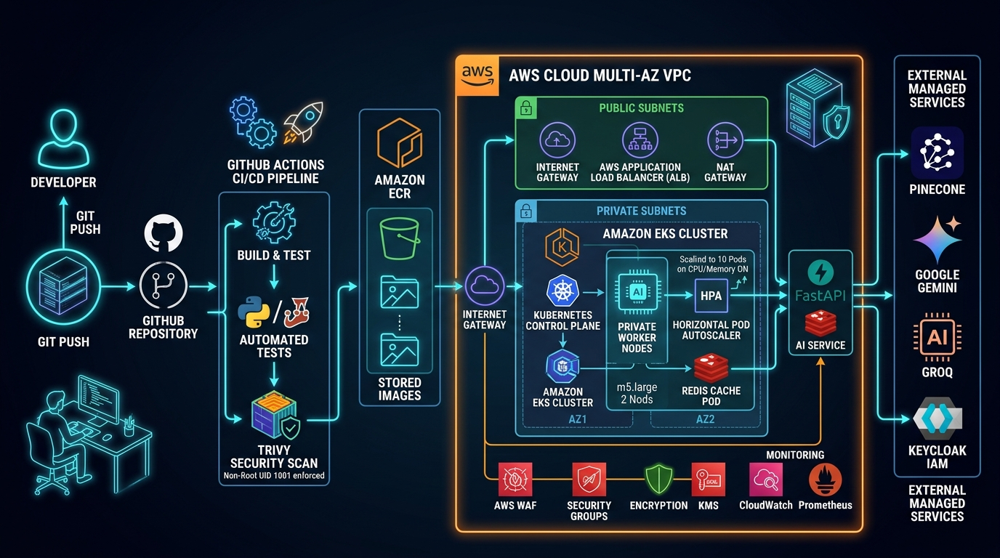

# AWS EKS Production Deployment Guide

This guide explains how to deploy the **Enterprise HR Policy Agentic RAG Copilot** onto an **Amazon EKS (Elastic Kubernetes Service)** cluster with zero downtime, auto-scaling, and AWS Application Load Balancer (ALB).



---

## 1. Prerequisites

1. **AWS CLI v2** installed and configured (`aws configure`).
2. **`kubectl`** installed.
3. **`eksctl`** installed (recommended tool to create EKS clusters).
4. **AWS IAM permissions** to manage EKS, ECR, IAM, and VPCs.

---

## 2. Step 1: Create an EKS Cluster (using `eksctl`)

Create a production-ready 2-node managed node group:

```bash
eksctl create cluster \
  --name enterprise-hr-eks-cluster \
  --region us-east-1 \
  --nodegroup-name standard-workers \
  --node-type t3.large \
  --nodes 2 \
  --nodes-min 2 \
  --nodes-max 6 \
  --managed
```

Update your local `kubeconfig`:
```bash
aws eks update-kubeconfig --region us-east-1 --name enterprise-hr-eks-cluster
```

Verify connection:
```bash
kubectl get nodes
```

---

## 3. Step 2: Install AWS Load Balancer Controller

The Ingress resource requires the AWS Load Balancer Controller to provision the Application Load Balancer (ALB):

```bash
# 1. Download IAM policy
curl -O https://raw.githubusercontent.com/kubernetes-sigs/aws-load-balancer-controller/v2.7.2/docs/install/iam_policy.json

# 2. Create IAM Policy
aws iam create-policy \
    --policy-name AWSLoadBalancerControllerIAMPolicy \
    --policy-document file://iam_policy.json

# 3. Associate OIDC provider
eksctl utils associate-iam-oidc-provider --region=us-east-1 --cluster=enterprise-hr-eks-cluster --approve

# 4. Create ServiceAccount
eksctl create iamserviceaccount \
  --cluster=enterprise-hr-eks-cluster \
  --namespace=kube-system \
  --name=aws-load-balancer-controller \
  --role-name AmazonEKSLoadBalancerControllerRole \
  --attach-policy-arn=arn:aws:iam::<YOUR_ACCOUNT_ID>:policy/AWSLoadBalancerControllerIAMPolicy \
  --approve

# 5. Install via Helm
helm repo add eks https://aws.github.io/eks-charts
helm repo update
helm install aws-load-balancer-controller eks/aws-load-balancer-controller \
  -n kube-system \
  --set clusterName=enterprise-hr-eks-cluster \
  --set serviceAccount.create=false \
  --set serviceAccount.name=aws-load-balancer-controller
```

---

## 4. Step 3: Create Amazon ECR Repository & Push Docker Image

```bash
# 1. Create ECR repo
aws ecr create-repository --repository-name enterprise-hr-copilot --region us-east-1

# 2. Log in to ECR
aws ecr get-login-password --region us-east-1 | docker login --username AWS --password-stdin <YOUR_ACCOUNT_ID>.dkr.ecr.us-east-1.amazonaws.com

# 3. Build & Tag Docker Image
docker build -t enterprise-hr-copilot:latest .
docker tag enterprise-hr-copilot:latest <YOUR_ACCOUNT_ID>.dkr.ecr.us-east-1.amazonaws.com/enterprise-hr-copilot:latest

# 4. Push to ECR
docker push <YOUR_ACCOUNT_ID>.dkr.ecr.us-east-1.amazonaws.com/enterprise-hr-copilot:latest
```

---

## 5. Step 4: Configure Secrets & Deploy

1. Open `k8s/secret.yaml` and insert your production API keys (`OPENAI_API_KEY`, `GEMINI_API_KEY`, `PINECONE_API_KEY`, etc.).
2. Update the image URL in `k8s/deployment.yaml` with your ECR image URI.
3. Deploy all manifests using Kustomize:

```bash
kubectl apply -k k8s/
```

---

## 6. Step 5: Verify Deployment & Status

Check the status of pods, services, and ingress:

```bash
# Check Pods
kubectl get pods -n enterprise-hr

# Check Rolling Update Deployment
kubectl rollout status deployment/hr-copilot-deployment -n enterprise-hr

# Check Ingress & get ALB Public URL
kubectl get ingress -n enterprise-hr
```

The output of `kubectl get ingress -n enterprise-hr` will show the **Address** (e.g. `k8s-enterprise-hr-xxxxxx.us-east-1.elb.amazonaws.com`). 
Open that URL in your browser to access the live copilot!

---

## 7. Useful Troubleshooting Commands

```bash
# View live application logs
kubectl logs -f deployment/hr-copilot-deployment -n enterprise-hr -c hr-copilot

# View Redis logs
kubectl logs -f deployment/redis-deployment -n enterprise-hr

# Check autoscaler status
kubectl get hpa -n enterprise-hr

# Describe pods for events/failures
kubectl describe pod <pod-name> -n enterprise-hr
```
